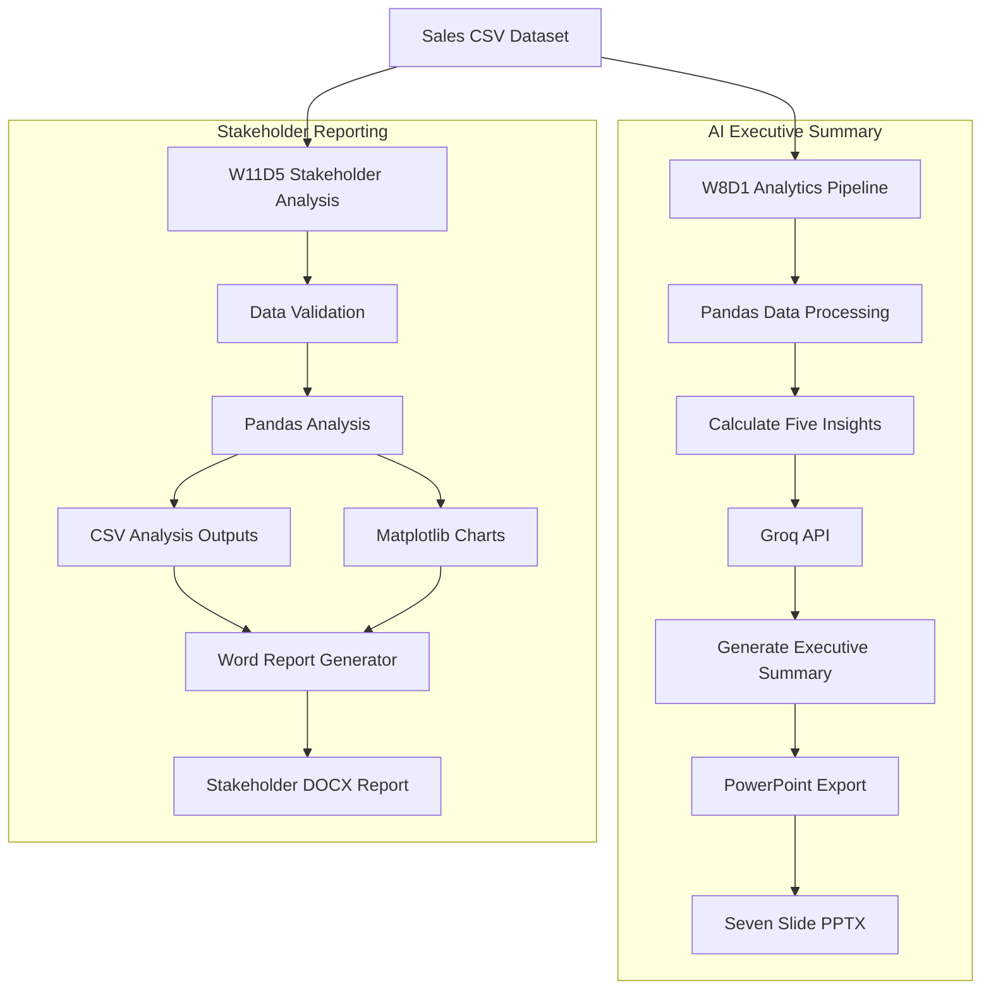
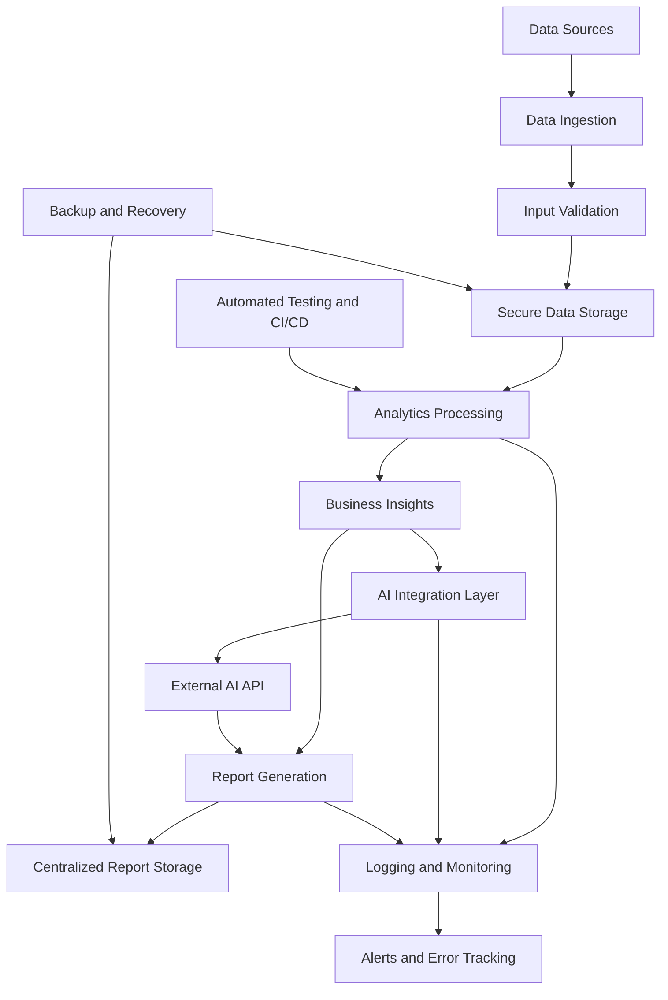

# W12D1 – Production Architecture Diagram

## 1. Existing Architecture

The diagram shows the two independently implemented analytics workflows reviewed in this assessment.

## 2. Recommended Production Architecture

## 3. Architecture Explanation

| Component            | Purpose                        |
| -------------------- | ------------------------------ |
| Data Sources         | Provides sales datasets        |
| Data Ingestion       | Receives input files           |
| Input Validation     | Checks data quality and format |
| Secure Storage       | Stores data safely             |
| Analytics Processing | Calculates business metrics    |
| AI Integration       | Generates AI-based summaries   |
| Report Generation    | Creates PPTX and DOCX reports  |
| Monitoring           | Tracks errors and performance  |
| Automated Testing    | Checks application quality     |
| Backup and Recovery  | Protects important data        |

## 4. Key Observation

The existing architecture uses local Python scripts and files. The recommended architecture introduces centralized storage, monitoring, secure API integration, automated testing, and backup mechanisms.

The recommended architecture is a proposed future design, not a description of infrastructure currently deployed.
